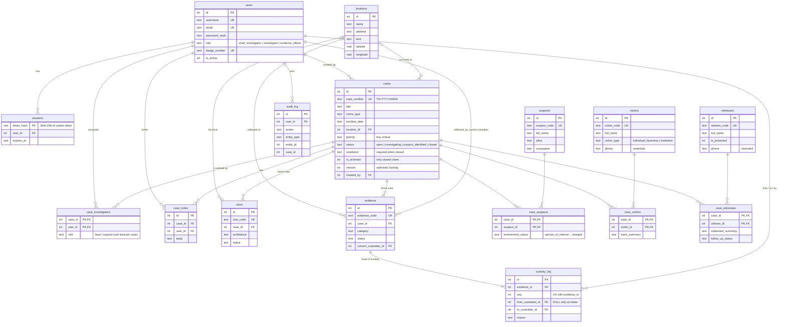
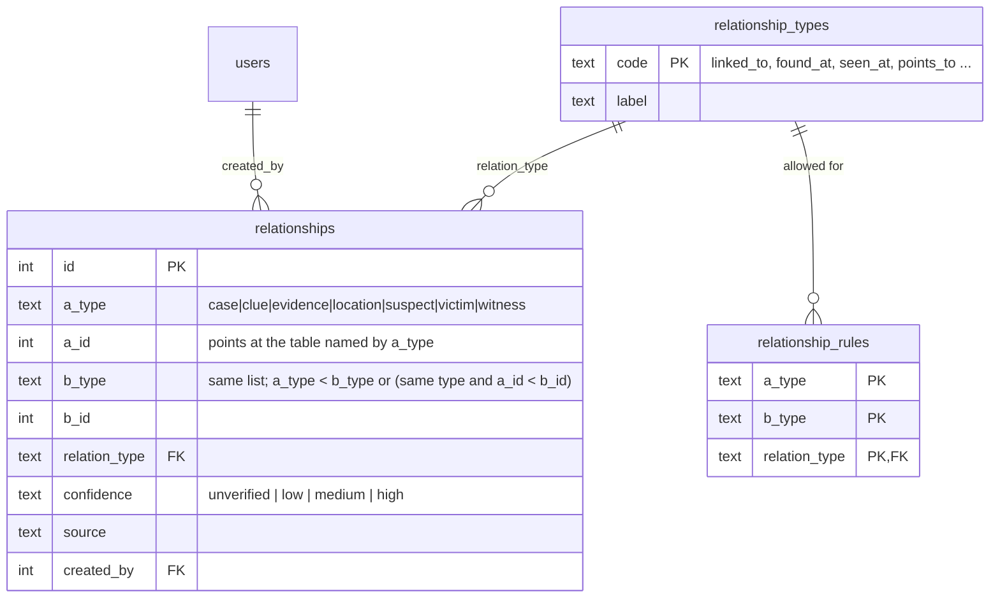

# TraceNet — Entity-Relationship Diagram and Schema Notes

The authoritative definition is in `database/migrations/` (generated into `database/schema.sql` by `npm run db:schema`). This page explains it.

GitHub, VS Code (with a Mermaid extension) and most Markdown viewers render the diagrams below.

## 1. Core ER diagram

`relationships` is drawn separately in section 2, because it is a *polymorphic* table that points at seven different tables and cannot be expressed with ordinary foreign keys.

## 2. The relationship engine tables

**Why a polymorphic table?** The graph must connect *any* record to *any* other (a clue to a location, evidence to a suspect, one case to another). A separate junction table for each of the 21 type pairs would be unmanageable, so there is one table whose endpoints are `(type, id)` pairs.

SQLite cannot declare a foreign key whose target table depends on a column, so the integrity that foreign keys would normally give is rebuilt in the database itself:

| Rule | Mechanism |
| --- | --- |
| Each edge is stored once, in canonical order (A→B and B→A cannot both exist) | `CHECK (a_type < b_type OR (a_type = b_type AND a_id < b_id))` |
| No duplicates | `UNIQUE (a_type, a_id, b_type, b_id, relation_type)` |
| Both endpoints exist | `BEFORE INSERT` trigger `trg_relationship_endpoints` |
| Only meaningful link types between two record kinds (e.g. *found at* only for clue/evidence ↔ location) | `relationship_rules` table + trigger `trg_relationship_rules` |
| Case ↔ suspect / victim / witness are **not** allowed here | `CHECK` — those links live in normalised junction tables |
| A "cross-case" link must point to a *different* case than the item's home case | trigger `trg_relationship_endpoints` |
| Deleting a record removes its edges | `AFTER DELETE` cleanup triggers on all seven tables |

The graph read-model is built from views:

* `v_graph_nodes` — one row per record that can appear as a node
* `v_graph_edges` — every edge, including the *implicit* ones from junction tables and `case_id` foreign keys, unioned with the explicit `relationships` rows
* `v_graph_edges_undirected` — both directions of each edge, used by the recursive traversal
* `v_node_degree`, `v_node_case_links` — hub detection (records connected to two or more cases)

## 3. Relationship cardinalities

| Relationship | Cardinality | Implemented by |
| --- | --- | --- |
| Case ↔ Suspect | many-to-many | `case_suspects` (adds `involvement_status`, notes) |
| Case ↔ Victim | many-to-many | `case_victims` (adds `harm_summary`) |
| Case ↔ Witness | many-to-many | `case_witnesses` (adds `statement_summary`, `interview_date`, `follow_up_status`) |
| Case ↔ Investigator | many-to-many | `case_investigators` (adds `role`; partial unique index = one lead) |
| Case → Evidence | one-to-many (home case) | `evidence.case_id` |
| Case → Clue | one-to-many (home case) | `clues.case_id` |
| Evidence → Custody entries | one-to-many, ordered | `custody_log (evidence_id, seq)` |
| Case → Location | many-to-one, optional | `cases.location_id` |
| Any record ↔ any record | many-to-many | `relationships` |

## 4. Normalisation

The schema is in **third normal form** (and BCNF for all tables with a single candidate key):

* **1NF** — all columns are atomic; there are no repeating groups. Lists such as a case's suspects or an evidence item's custody history are rows in their own tables, not comma-separated values.
* **2NF** — in tables with composite keys (`case_suspects`, `case_victims`, `case_witnesses`, `case_investigators`) every non-key column describes the *pair*, not half of it: *involvement status* belongs to "this suspect in this case", not to the suspect or the case alone. That is the reason these are junction tables and not columns on `suspects`.
* **3NF** — no non-key column depends on another non-key column. A suspect's name is stored once in `suspects`; cases refer to it by key. A person's role is stored in `users`, not copied into `case_investigators`. Reference vocabularies (`relationship_types`, `relationship_rules`) are tables, not repeated strings.

**Deliberate, documented trade-offs**

* `evidence.current_custodian_id` duplicates what could be derived from the `to_custodian_id` of the last `custody_log` row. This is a controlled denormalisation so lists and filters do not need a join and a "latest row" subquery on every request. The `trg_custody_chain` trigger guards how new entries are added, and the view `v_custody_violations` reports any evidence item whose stored custodian differs from its ledger (it should always return zero rows; the ADBMS Lab health tab shows this).
* `audit_log.case_id` and `audit_log.entity_id` are plain integers, not foreign keys, because an audit row can refer to any of several tables. Only `user_id` is a real foreign key.

## 5. Integrity features by table

| Feature | Where |
| --- | --- |
| Enumerations enforced by `CHECK` | status, priority, crime type, role, confidence, category, follow-up status … |
| Date/time format checks | `GLOB 'YYYY-MM-DD'` checks on all date columns |
| Cross-column rules | A case is closed ⇔ it has `closed_at` **and** a `resolution`; only closed cases can be archived |
| Partial unique index | `uq_case_single_lead` — at most one lead investigator per case |
| `ON DELETE RESTRICT` | People, evidence and clues cannot vanish from under a case; the API offers *unlink* and *archive* instead |
| `ON DELETE CASCADE` | Only on dependent rows that have no meaning alone (sessions, case notes, junction rows when a case is deleted) |
| Append-only tables | `custody_log`, `audit_log` — `BEFORE UPDATE` / `BEFORE DELETE` triggers raise an error |
| Custody chain | Trigger `trg_custody_chain` — intake has no previous custodian; sequence numbers have no gaps; `from` must equal the last holder; disposed items cannot move |
| Archived cases are read-only | `BEFORE INSERT` triggers on evidence, clues and the people junction tables |
| `updated_at` maintenance | `AFTER UPDATE` touch triggers; child inserts also touch their parent case so the board's "recently updated" sort is truthful |
| Full-text search | FTS5 virtual table `search_index`, kept in sync by insert/update/delete triggers on seven tables |
| Optimistic concurrency | `cases.version`; updates run `WHERE id = ? AND version = ?` |

## 6. Indexes

| Index | Serves |
| --- | --- |
| `idx_cases_status (is_archived, status)` | Board columns and status filters |
| `idx_cases_priority`, `idx_cases_incident_date`, `idx_cases_updated`, `idx_cases_location` | Filters and sorts on the list/board |
| `idx_evidence_case`, `idx_clues_case` | Foreign-key lookups: "evidence of this case" |
| `idx_evidence_status / category / custodian / location` | Evidence filters and joins |
| `idx_case_suspects_suspect` (and victim/witness/investigator equivalents) | Reverse lookup: "which cases involve this person?" — the junction's primary key covers only the case → person direction |
| `idx_suspects_name` (`COLLATE NOCASE`) | Case-insensitive name lookup |
| `idx_relationships_b (b_type, b_id)` | The unique key covers lookups from endpoint A; this covers endpoint B |
| `UNIQUE (evidence_id, seq)` | Latest custody entry, ordered chain |
| `idx_audit_created / entity / case / user` | Activity log filters |
| `idx_sessions_user`, `idx_sessions_expires` | Sign out everywhere, expiry purge |

The ADBMS Lab's **Query plans** tab shows `EXPLAIN QUERY PLAN` output for these (e.g. `SEARCH … USING INDEX` versus `SCAN`).
